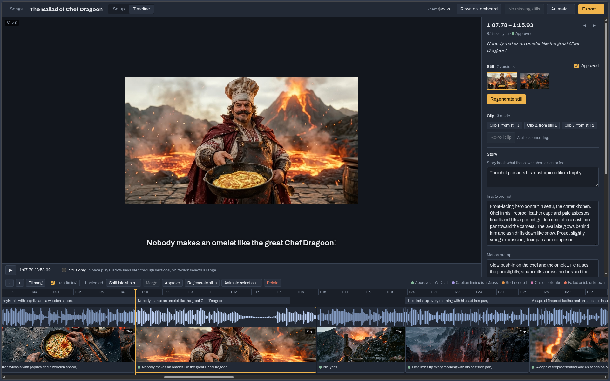

# music-video-creator

Non-linear music video editor with export to MP4 and Blender files.



Give it a song and its lyrics. It times every lyric line to the audio, writes a
storyboard, makes a still for each shot, and animates the stills you approve.
You edit on a timeline, then export one MP4 with burned-in captions, plus a
Blender project with every clip at its timecode.

All models run through [OpenRouter](https://openrouter.ai): transcription, the
storyboard, stills and video. A whole song in stills costs about $1; clips are
priced per second (Grok Imagine Video 1.5 is $0.08/s at 480p).

## Setup

You need [uv](https://docs.astral.sh/uv/) and an OpenRouter key in `.env` at the
repo root:

```
OPENROUTER_API_KEY=sk-or-...
```

Blender is optional. If `/opt/blender-5.1.2-linux-x64/blender` exists, export
also writes `music_video.blend`; to use another install, change `BLENDER` in
`app/pipeline.py`.

## The web app

```
uv run --with imageio-ffmpeg --with numpy --with pillow python app/server.py
```

Then open http://localhost:8780. Run it in your own terminal and leave it
running; clip jobs that are in flight when it stops resume when it starts again.

| Switch | What it does |
|---|---|
| `--port <n>` | Listen on port `n` instead of 8780. The server only accepts connections from this machine. |

Songs are saved in `songs/<name>/` (not in git): audio, lyrics, plan, every
still and clip version, and exports.

### Import an mv/ song folder

```
uv run --with imageio-ffmpeg --with numpy --with pillow python app/import_media.py <folder> ["Title"]
```

| Argument | What it does |
|---|---|
| `<folder>` | An mv/ song folder (like `media/`). It is only read, never changed. |
| `"Title"` | The song's name in the library. Defaults to the folder name. |

Brings in the audio, lyrics, brief and transcript, re-times the lyrics, keeps the
shots and prompts, and adds each still as version 1 and each clip as clip 1.

## Command-line pipeline (mv/)

The scripts the app grew out of. Each one works on a song folder holding
`song.wav`, `lyrics.txt` and `brief.txt`, and the steps run in order.

| Step | Command | What it does |
|---|---|---|
| 1 | `python3 mv/transcribe.py <song_dir> [--full] [--model <id>]` | Timed words from the audio, written to `transcript.json`. Sends a 16 kHz mono copy; `--full` sends the original WAV. `--model` picks the OpenRouter transcription model (default `elevenlabs/scribe-v2`, which times every word). |
| 2 | `python3 mv/align.py <song_dir>` | Times each line of `lyrics.txt` against the transcript, written to `lines.json`. |
| 3 | `python3 mv/storyboard.py <song_dir> [--model <id>]` | One shot per lyric line with an image prompt and a motion prompt, written to `plan.json`. `--model` picks the OpenRouter model (default `anthropic/claude-sonnet-5.5`). |
| 4 | `python3 mv/finish.py <song_dir> fetch` | Downloads each shot's `still_url` / `video_url` from `plan.json`. |
| 4 | `python3 mv/finish.py <song_dir> sheet` | Makes `stills/contact_sheet.jpg` so you can review every still at once. |
| 5 | `uv run --with imageio-ffmpeg python mv/finish.py <song_dir> clips` | Trims each clip to its slot in the song: `clips/` with captions, `clean/` without, plus `lyrics.srt`. |
| 6 | `uv run --with imageio-ffmpeg python mv/preview.py <song_dir> [gap_image]` | `preview.mp4`: every clip at its exact time over a background image, with the song. The image defaults to `gap_stage.png`. |
| 7 | `blender -b --factory-startup --python mv/blend.py -- <song_dir> [gap_image]` | `music_video.blend`: song, background image, captioned and clean clips on separate channels, a marker per lyric line. |

Helpers for recording finished media URLs in `plan.json`:

| Command | What it does |
|---|---|
| `python3 mv/setvideo.py <song_dir> <shot id>=<url> ...` | Sets `video_url` for the given shots. |
| `python3 mv/record.py <song_dir> still\|video <jobs.txt> <creation_list.json>...` | Copies finished OpenArt URLs into `plan.json` and lists shots that are still pending or failed. |

More about how the app is put together: [app/README.md](app/README.md).

MIT licensed, see [LICENSE](LICENSE). Created in [T3 Code](https://t3.codes).
